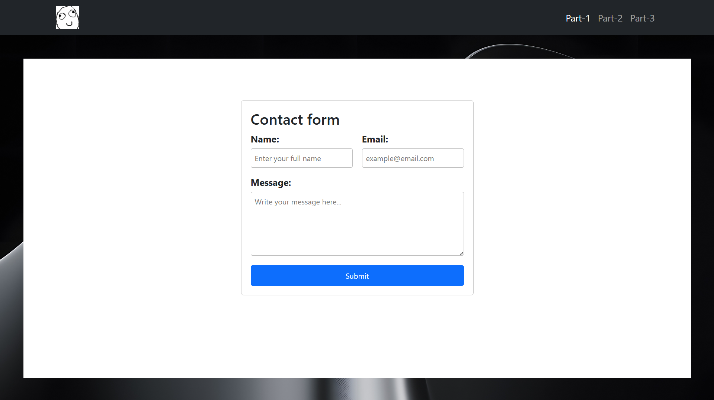
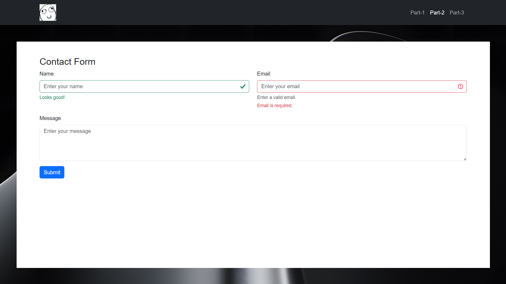
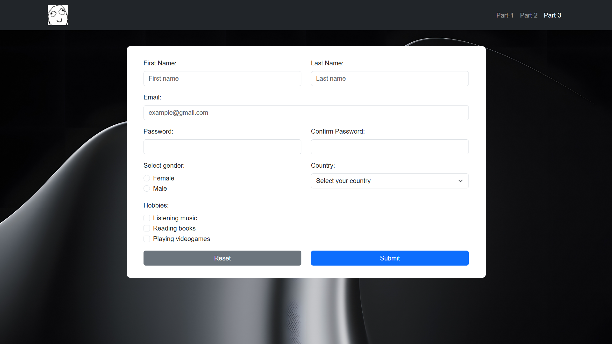

# Assignment 4
## Group: SE-2539
## Full name: Aktanbi Kusman
## Course: WEB Technologies 1 ( Frontend )

## Overview
In this assignment I learned how to write html forms and how to implement it also with bootstrap.

In this project there are 4 pages:
* index.html - its just home page, all required tasks in other 3 pages
* part-1.html - consists tasks from 'Part 1'
* part-2.html - consists tasks from 'Part 2'
* part-3.html - consists tasks from 'Part 3'

What about styles. I wrote css files for each page.

## Part 1

In this part I wrote basic html contact form. I divided levels of form to 3 containers named form-level-1/2/3. And for each one I used different css properties. ALSO, I added in input tags attributes such as 'min/maxlength' and 'required' to validate.

## Part 2

In second part I had to recreate contact form with bootstrap framework. I added `div class="in-invalid/valid"` and there are displayed only as example. Lets say that we write correct email but there is also will show `email required` at below of input. 

## Part 3

In tird part I wrote Registration form using all Bootstrap grid system and bootstrap framework. When I didnt know how can I write for example Country list, I just googled it and learned. It was good experience for me. Now I understand how it should look like.   